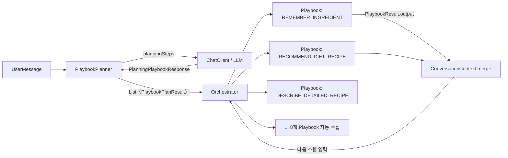
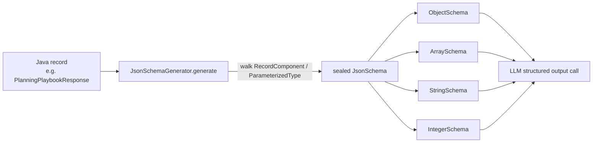
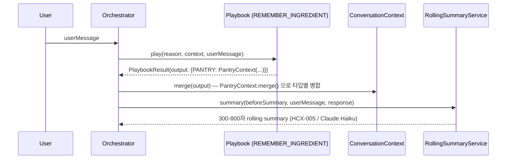

# Architecture — Dayum AI Agent Orchestrator

Spring Boot 기반 음식 도메인 LLM 에이전트. 서로 다른 역할을 가진 **Playbook sub-agent 8종**을 LLM Planner 가 조합해 멀티스텝 플랜으로 실행한다. 이 문서는 포트폴리오 리뷰어가 코드를 열어보지 않고도 핵심 설계 결정을 이해할 수 있도록 작성되었다.

- 측정: `src/main` 기준 77 Java 파일 · 3,920 LOC
- LLM: Anthropic Claude Sonnet / Haiku (프록시: `${ANTHROPIC_BASE_URL}`). Clova HCX-005/007 호환성 유지 (`chat.provider=clova`)

---

## 1. Playbook 패턴 (Sub-agent 아키텍처)

초기 설계는 flat `Tool`/`ToolRegistry` 구조였으나 (PR #1, #3, #8), PR #9/#11/#13/#14 에 걸쳐 **Playbook sub-agent** 아키텍처로 전환되었다. PR #14 단독으로 +401 / -509 lines — 기존 tool 계층을 완전히 교체.

**핵심 요소:**
- `Playbook` 인터페이스 (`application/orchestrator/playbook/Playbook.java:11`) — 각 sub-agent 는 `getCatalog()` 로 **agent card** (action/trigger/requiresContext/outputContext/cautions) 를 자가 선언.
- Spring `List<Playbook>` 자동 주입 — 신규 sub-agent 추가 비용 = `@Component` Playbook 구현체 1개 + `PlaybookType` enum 1줄. 수동 라우팅 코드 0줄.
- `Orchestrator` (86 LOC, [`Orchestrator.java`](src/main/java/dayum/aiagent/orchestrator/application/orchestrator/Orchestrator.java)) 가 플랜을 순차 실행, 각 스텝의 `output()` 을 `context.merge()` 로 다음 스텝에 전파.

---

## 2. Planner Prompt DSL

`ChatPrompt.PlannerPrompt.SYSTEM_MESSAGE` (`ChatPrompt.java:30-103`) 은 LLM Planner 가 **context-key evolution 시뮬레이션** 을 수행하도록 설계된 프롬프트 DSL.

**프롬프트 책임:**
1. **Hard constraints** — playbook_id ⊂ PLAYBOOK_LIST ∩ PLAYBOOK_CATALOG.id, priority 1..N, N≤3
2. **Gate 규칙** — 각 playbook 포함 조건 (예: `RECOMMEND_DIET_RECIPE` 는 `CURRENT_CONTEXT_KEY` 에 `PANTRY` 존재 전제)
3. **Simulation protocol** — 각 스텝 실행 후 outputContext 를 다음 평가의 CURRENT_CONTEXT_KEY 에 반영
4. **우선 심사 순서** — GUARDRAIL → SMALL_TALK → 나머지
5. **Worked examples** — 8개 케이스 (재료 저장 → 추천, QuickReply 응답, 상세 레시피 선택 등)

이 구조로 플래너는 단일 호출로 다단계 플랜을 결정론적으로 조립한다.

---

## 3. Reflective JSON Schema (103 LOC)

Clova / Anthropic structured-output 호출에 필요한 JSON Schema 를 **응답 DTO 로부터 리플렉션으로 자동 생성**.

- `JsonSchemaGenerator` ([`JsonSchemaGenerator.java`](src/main/java/dayum/aiagent/orchestrator/client/chat/schema/JsonSchemaGenerator.java), 103 LOC) 가 Java `record` / `class` / `enum` / `ParameterizedType` / `RecordComponent` 를 walk.
- `JsonSchema` 는 sealed interface (4 variants: `Object` / `Array` / `String` / `Integer`) — Jackson 직렬화 타입 안전 보장.
- `@JsonProperty(required=true)` + primitive 타입 → required 필드 자동 산출.
- **DTO 1개 = Schema 1개 = 진실 소스 1개.** 신규 structured output 추가 비용: response record 선언 1개.
- Drift 감지: `JsonSchemaGeneratorSnapshotTest` + `src/test/resources/golden/planning-schema.json`.

---

## 4. 2단 대화 메모리

대화 메모리는 **typed domain memory + LLM rolling summary** 로 구성된다.

**Layer A — Typed domain memory:**
- `Map<ContextType, ContextValue>` (`ConversationContext`)
- `ContextValue` 는 **sealed interface** (`permits PantryContext, RecommendedRecipeContext, TasteAttributeContext` — 3개 타입)
- 각각 `ContextValue merge(ContextValue newValue)` 를 타입별로 정의 — 예: `PantryContext.merge()` 는 재료명 dedupe + 수량 문자열 concat
- 신규 메모리 타입 추가 비용: `ContextValue` subtype 1개 + `ContextType` enum 1줄 + `Remember{X}Playbook` 1개 (PR #22 는 +126 / -4 로 검증)

**Layer B — LLM Rolling Summary:**
- `RollingSummaryService` 가 매 턴 Claude Haiku 로 재요약 — **300-800자**, hallucination off, goals/constraints/decisions/next-steps 우선
- 2 레이어가 **독립 저장소** (`DomainContextRepository`, `RollingSummaryRepository`) — 유형별 교체 가능

**설계 효과:** 토큰 비용 bounded (summary 길이 상한 + typed context 는 summary 외부).

---

## 5. Self-correcting Replan Loop

T0-2 로 추가 — `Orchestrator` 의 silent `break` 를 bounded replan 으로 교체.

**동작:**
1. 플랜 실행 중 스텝이 `requiresContext` 를 만족 못 함을 감지 (`findMissingContexts`).
2. `FailedStep{playbookType, reason, missingContexts}` 를 `PlaybookPlanner.replan()` 에 전달.
3. 플래너는 `USER_MESSAGE_TEMPLATE_REPLAN` 프롬프트로 LLM 에 **직전 실패 사유 + 누락 키 + "동일 플랜 반복 금지"** 를 명시, 새 플랜 산출.
4. 재계획이 성공하면 이어서 실행. 실패 시 cap=2 까지 반복, 그 이상은 "정보 부족" 사용자 안내로 종료.

**결과:** 플래너 할루시네이션으로 인한 복구불가 플랜 실패가 1회 → 최대 3회 (initial + 2 replans) 시도로 완화. 쓰래싱 방지는 cap + 프롬프트의 "동일 플랜 반복 금지" + 실행 결과 반영된 context key 재주입으로 확보.

**검증:** `OrchestratorReplanTest`
- `replan_recoversFromMissingContext` — 빈 PANTRY → `[RECOMMEND_DIET_RECIPE]` 플랜 → replan → `[REMEMBER_INGREDIENT, RECOMMEND_DIET_RECIPE]` 복구
- `replan_cappedAtMaxReplan_whenPlannerKeepsFailing` — 플래너가 계속 실패 플랜 반환 → 정확히 2회 replan 후 종료

---

## 6. Known Limitations (의도적 미구현)

포트폴리오 시연 범위 정의. 리뷰어의 "왜 X 가 없죠?" 질문에 대한 선제 답변.

| 항목 | 현재 상태 | 왜 안 했나 / 다음 단계 |
|---|---|---|
| **State persistence** | `DomainContextInMemoryRepository`, `RollingSummaryInMemoryRepository` — 프로세스 재시작 시 상태 소실 | 데모 범위. Redis swap 은 `ContextRepository` 빈 1개 교체 거리 (Tier 1 로 보류) |
| **Observability** | SLF4J 로그만. 메트릭/트레이스 없음 | Micrometer + `ClovaStudioChatClient.sendRequest` 래핑으로 토큰/레이턴시 가시화 가능 — Tier 1 |
| **WebSocket** | `AiChatHandler` ([`AiChatHandler.java`](src/main/java/dayum/aiagent/orchestrator/application/websocket/AiChatHandler.java)) 는 echo stub | REST 경로가 end-to-end 동작하므로 데모 충분. 세션/백프레셔/이벤트 스키마는 10h+ 구덩이로 보류 |
| **Retry / Circuit breaker** | 미구현 | 데모 가치 낮음. 운영 투입 시 Spring Retry + Resilience4j 추가 |
| **Tool-calling 재도입** | PR #14 에서 의도적 삭제 | Playbook 아키텍처 네러티브와 상충. 복원 안 함 |
